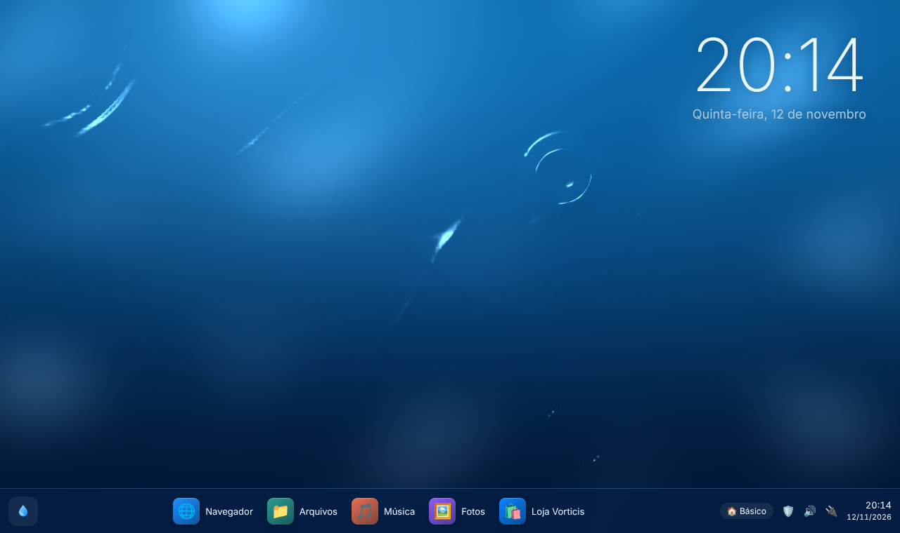
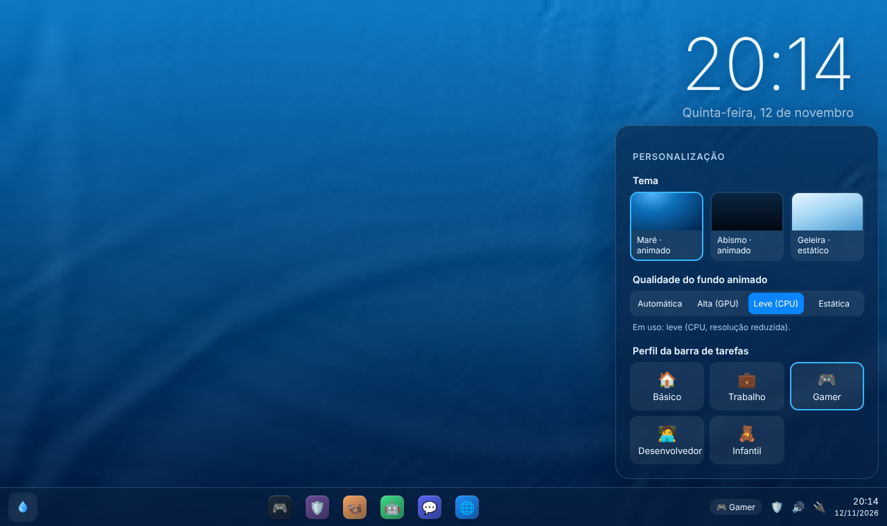

# Vorticis SO

Sistema operacional **híbrido, leve e bonito**, construído sobre o kernel Linux (base Debian 13 "trixie"),
com camadas de compatibilidade para rodar software de **Windows, Linux, Android e (parcialmente) macOS**.

> Tema inicial **"Maré"**: tons de azul e um plano de fundo de água que ondula quando o mouse passa por cima —
> com modo de economia (Canvas 2D / imagem estática) para máquinas sem GPU dedicada.





## Por que sobre Linux?

Escrever um kernel do zero levaria anos só para alcançar suporte a drivers de rede, vídeo e USB.
Usando o kernel Linux + Debian, o Vorticis herda suporte a milhares de dispositivos, atualizações de
segurança e um ecossistema enorme — e concentra o esforço no que o torna único: a experiência,
a compatibilidade híbrida e as ferramentas inteligentes.

## O que já existe neste repositório

| Área | Onde | Status |
|---|---|---|
| Build da ISO (live USB) | [`build/`](build/) | Configuração `live-build` + pacotes + hooks |
| Shell / área de trabalho | [`shell/`](shell/) | Protótipo funcional: água interativa (WebGL + fallback), barra de tarefas adaptável ao perfil, motor de temas |
| Temas | [`shell/themes/`](shell/themes/) | `mare` (padrão, animado), `abismo` (escuro), `geleira` (estático, leve) |
| Compatibilidade de apps | [`tools/vorticis-compat`](tools/vorticis-compat) | Instala `.exe/.msi`, `.apk`, `.deb`, `.rpm`, `.AppImage`, `.flatpakref`, `.dmg` pela camada certa |
| Caçador de drivers | [`tools/vorticis-drivers`](tools/vorticis-drivers) | Detecta hardware (PCI/USB/modalias), sugere e instala drivers e firmware (fwupd) |
| Gerência de recursos | [`tools/vorticis-recursos`](tools/vorticis-recursos) | zram, OOM inteligente, perfis de energia, limpeza e TRIM |
| Usuários e níveis de acesso | [`tools/vorticis-usuarios`](tools/vorticis-usuarios) | Administrador, Padrão, Convidado, Infantil (grupos + polkit) |
| Segurança de rede | [`security/`](security/) + [`tools/vorticis-rede`](tools/vorticis-rede) | nftables (nega entrada por padrão), DNS-over-TLS, MAC aleatório, AppArmor, filtro DNS familiar |
| Navegadores | [`tools/vorticis-navegadores`](tools/vorticis-navegadores) | Firefox, Chromium, Chrome, Brave, Edge, Opera, Vivaldi + navegador padrão |
| Instalador | [`installer/`](installer/) | Calamares (pen-drive) + instalação a partir de sistema ativo (Linux e Windows) |

Documentação: [Arquitetura](docs/ARQUITETURA.md) · [Compatibilidade](docs/COMPATIBILIDADE.md) · [Roteiro](docs/ROTEIRO.md)

## Experimentar o visual agora (sem instalar nada)

```bash
cd shell && python3 -m http.server 8080
# abra http://localhost:8080 no navegador
```

## Gerar a ISO

Em uma máquina Debian/Ubuntu (ou container Debian) com acesso root:

```bash
sudo apt install live-build
cd build && sudo ./build.sh
# resultado: build/vorticis-<versão>-amd64.iso
```

Gravar no pen-drive: `sudo dd if=vorticis-*.iso of=/dev/sdX bs=4M status=progress oflag=sync`
(ou use Ventoy, balenaEtcher, Rufus em modo DD).

## Requisitos mínimos (meta)

- CPU x86-64 de 2 núcleos, 2 GB de RAM (4 GB recomendados para Android/Windows apps)
- 20 GB de disco
- Qualquer GPU com OpenGL 2.1 / GLES 2 — sem ela, o tema cai automaticamente para o modo leve

## Licença

GPL-3.0-or-later para o código próprio do Vorticis. Componentes de terceiros mantêm suas licenças.
