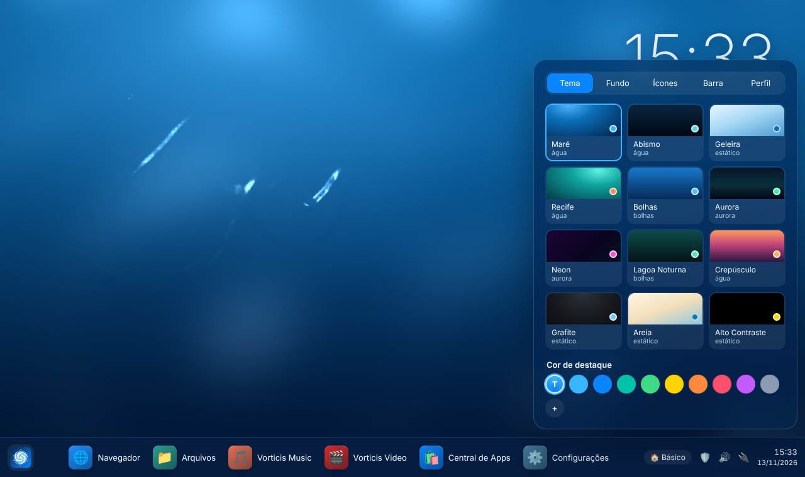
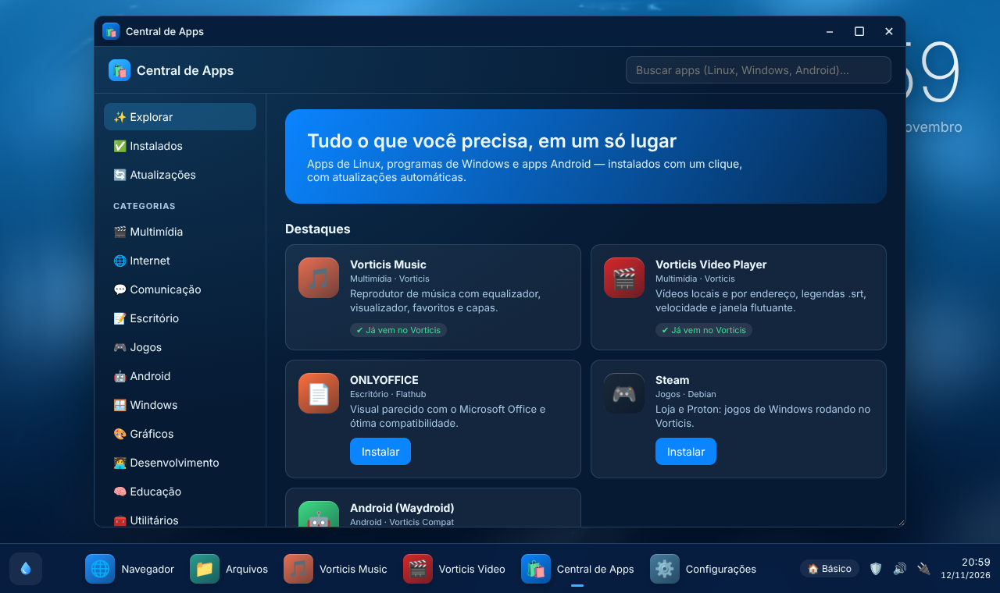
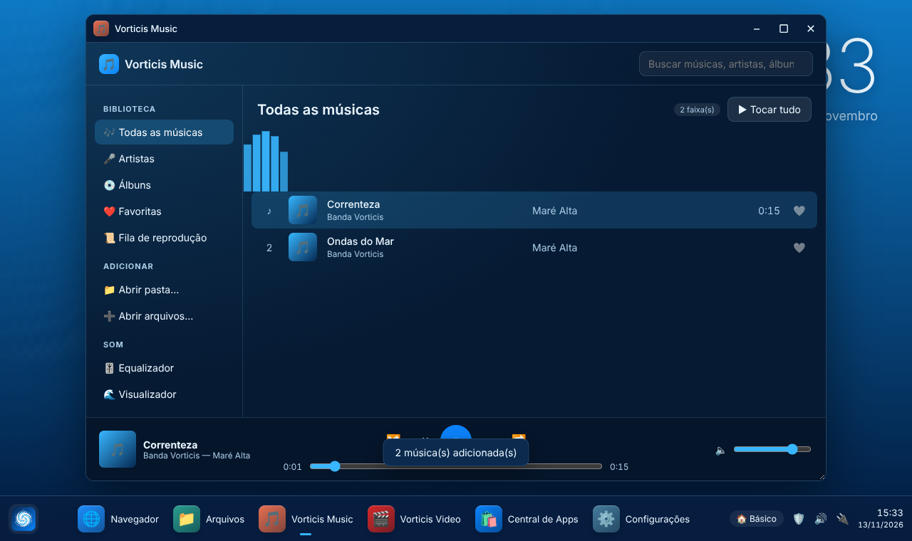
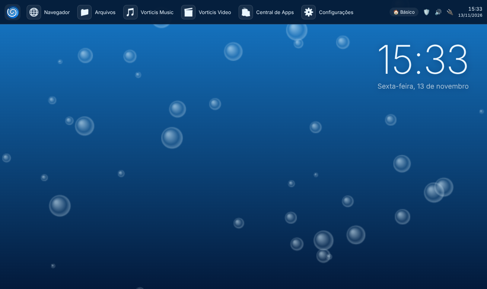
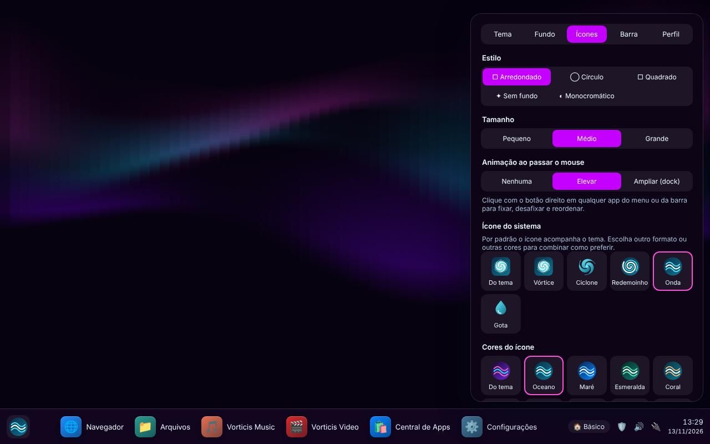

# Vorticis SO

Sistema operacional **híbrido, leve e bonito**, construído sobre o kernel Linux (base Debian 13 "trixie"),
que roda programas de **Linux, Windows e Android**.

> Tema inicial **"Maré"**: tons de azul e um plano de fundo de água que ondula quando o mouse passa por cima —
> com modo de economia (CPU / estático) para máquinas sem GPU dedicada. Outros 11 temas: bolhas, aurora, recife,
> crepúsculo, neon, grafite, alto contraste…


| | |
|---|---|
|  |  |
|  |  |

## Ícone do sistema

O ícone do Vorticis é um vórtice (da mesma família do [Vorticis Monitor](https://github.com/hellisonvidal/Vorticis-Monitor)).
Ele acompanha o tema escolhido, mas pode ser trocado à parte em **Personalização → Ícones**: 5 formatos
(Vórtice, Ciclone, Redemoinho, Onda, Gota) e 10 combinações de cores. A fonte única é
[`shell/js/logo.js`](shell/js/logo.js); `node branding/gerar-logo.js` gera os arquivos usados no menu de boot,
na tela de inicialização (Plymouth), no instalador (Calamares), no pen-drive (ícone da unidade no Windows) e
nos ícones do sistema.



## Baixar e instalar

Versões prontas ficam em **[Releases](https://github.com/hellisonvidal/Vorticis-SO/releases)** —
ISO para pen-drive, instalador para Windows e instalador para Linux. Veja [`installer/`](installer/).

## O que vem no Vorticis

| Área | Onde | O que faz |
|---|---|---|
| Área de trabalho | [`shell/`](shell/) | Água/bolhas/aurora interativas, 12 temas, cor de destaque, imagem própria, 5 estilos de ícones, barra em cima/embaixo, centralizada/à esquerda, transparência, ocultar, relógio 12/24 h, fixar e reordenar apps, perfis (Básico, Trabalho, Gamer, Dev, Infantil) |
| Vorticis Music | [`shell/apps/musica`](shell/apps/musica) | Biblioteca, capas e tags ID3, artistas/álbuns, favoritos, fila, aleatório/repetir, equalizador de 5 bandas, visualizador, teclas de mídia |
| Vorticis Video Player | [`shell/apps/video`](shell/apps/video) | Lista, legendas .srt/.vtt, velocidade, retomar de onde parou, captura de quadro, janela flutuante, atalhos |
| Central de Apps | [`shell/apps/central`](shell/apps/central) + [`tools/vorticis-apps`](tools/vorticis-apps) | Gerenciador de aplicativos: 60+ apps selecionados, Flathub, Debian, Android e Windows; instalados e atualizações (sistema, apps, firmware) |
| Dispositivos | [`shell/apps/dispositivos`](shell/apps/dispositivos) + [`tools/vorticis-dispositivos`](tools/vorticis-dispositivos) | Gerenciador de dispositivos: hardware por categoria, estado, propriedades, ativar/desativar, reiniciar driver, ejetar e **procurar drivers por dispositivo** |
| Diagnóstico | [`shell/apps/diagnostico`](shell/apps/diagnostico) + [`tools/vorticis-diagnostico`](tools/vorticis-diagnostico) | 16 verificações (serviços, pacotes, discos/SMART, memória, temperatura, drivers, rede, segurança...), nota de saúde, correções e relatório |
| Atualizações | [`tools/vorticis-atualizar`](tools/vorticis-atualizar) + [`pacote/`](pacote/) | Novas versões do Vorticis direto das releases (pacote `vorticis-sistema`, SHA-256 conferido), aviso a cada 12 h, sistema/apps/firmware |
| Ferramentas de sistema | [`shell/apps`](shell/apps) | Configurações, Monitor, Notas, Calculadora, Ajuda; backup e pontos de restauração |
| Windows | [`tools/vorticis-compat`](tools/vorticis-compat) | Wine com prefixo por programa e receitas automáticas; VM Windows integrada para Office 365/AutoCAD/Adobe; 5 caminhos para Office |
| Jogos e anti-cheat | [`tools/vorticis-jogos`](tools/vorticis-jogos) | Consulta se o anti-cheat de cada jogo funciona; Steam/Proton, EAC/BattlEye, Proton-GE |
| Android | [`tools/vorticis-compat`](tools/vorticis-compat) | Waydroid: apps Android nativos, `.apk` com dois cliques |
| Drivers | [`tools/vorticis-drivers`](tools/vorticis-drivers) | GPUs NVIDIA/AMD/Intel e híbridas, Wi-Fi, Bluetooth, áudio, Thunderbolt, digital, controles, Wacom, impressoras/scanners, firmware/BIOS, kernel novo para hardware recente |
| Telas | [`tools/vorticis-tela`](tools/vorticis-tela) | Todas as resoluções e taxas do monitor, escala automática (HiDPI), modos personalizados, vários monitores |
| Recursos | [`tools/vorticis-recursos`](tools/vorticis-recursos) | zram, proteção contra travamentos, perfis de energia, limpeza, TRIM |
| Usuários | [`tools/vorticis-usuarios`](tools/vorticis-usuarios) | Administrador, Padrão, Convidado, Infantil (horário e filtro de sites) |
| Rede e segurança | [`security/`](security/) + [`tools/vorticis-rede`](tools/vorticis-rede) | Firewall que bloqueia entradas, DNS criptografado, MAC aleatório, AppArmor |
| Navegadores | [`tools/vorticis-navegadores`](tools/vorticis-navegadores) | Firefox, Chromium, Chrome, Brave, Edge, Opera, Vivaldi + padrão e aceleração por GPU |
| Instaladores | [`installer/`](installer/) | Pen-drive (Calamares), a partir do Windows e a partir de um Linux em uso |

## Documentação

| Documento | Para quem |
|---|---|
| [Manual do usuário](docs/MANUAL.md) | quem usa o Vorticis (também no app **Ajuda**, dentro do sistema) |
| [Programas de Windows e Android](docs/COMPATIBILIDADE.md) | o que roda e como |
| [Referência de comandos](docs/REFERENCIA.md) | todas as ferramentas `vorticis-*` (gerada da ajuda de cada uma) |
| [Como o Vorticis funciona](docs/ARQUITETURA.md) | visão técnica |
| [Guia de desenvolvimento](docs/DESENVOLVIMENTO.md) | quem mantém ou contribui |
| [Novidades](docs/NOTAS-DA-VERSAO.md) · [Roteiro](docs/ROTEIRO.md) | o que mudou e o que vem |

## Experimentar o visual agora (sem instalar nada)

```bash
cd shell && python3 -m http.server 8080
# abra http://localhost:8080 — os apps Vorticis abrem em janelas de demonstração
```

## Gerar a ISO

Em Debian 13 (ou contêiner `debian:trixie --privileged`), como root:

```bash
apt install live-build
cd build && ./build.sh          # resultado: build/vorticis-0.2-amd64.iso
```

Ou crie uma tag `vX.Y` no GitHub: o CI gera a ISO e publica a release automaticamente.

## Requisitos mínimos

- CPU x86-64 de 2 núcleos, 2 GB de RAM (4 GB recomendados para Android/Windows)
- 20 GB de disco · UEFI ou BIOS
- Qualquer GPU com OpenGL 2.1 / GLES 2 — sem ela, o tema cai automaticamente para o modo leve

## Licença

GPL-3.0-or-later para o código próprio do Vorticis. Componentes de terceiros mantêm suas licenças.
